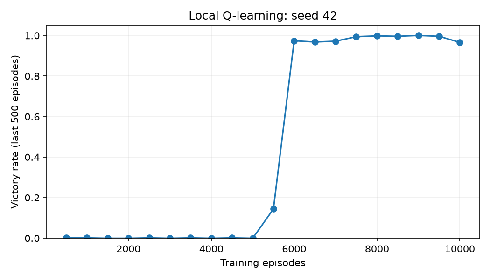

# 第 8 章｜实验记录

本次在 Windows 的项目 `.venv` 中执行。普通脚本与模型请求的命令、退出码、耗时和日志都保存在 `results/`。离线演示和测试通过，仅对应它们检查到的内容。

本机检查：6 组命令中 6 组退出成功；pytest 的末次汇总为 `{'passed': 66}`。首次失败日志保留在 `checks/*.attempt*.txt`，没有从统计中删掉失败后假装从未发生。

[检查汇总](results/check-summary.json) · [历史材料抽查](results/saved-evidence-review.json)

历史抽查固定在 Git 提交 `faa6db95`，每份 JSON 最多检查 40 个声明文件；使用原始 Git 字节，避免 Windows 换行影响。未能解析的旧路径、未跟踪产物和实际哈希差异会出现在报告中，因此这份抽查不是“所有历史验收重新通过”的证明。

## 本次实际训练

[Q-learning 记录](results/q-learning.json)：seed 42，10,000 轮训练；100 轮贪心评估胜率 100%，平均 12 步。累计训练胜率 45.1% 包括探索期，不能与最后贪心评估直接混为同一指标。

这是真实表格型 Q-learning，不是 LLM 权重微调。其余演示的 mock 指标和作者保存的训练报告都按来源标明。

## 8-1｜Q-learning 在寻宝游戏中的表现

本机实际训练 10,000 轮，固定 seed=42，100 轮贪心评估 100/100，平均 12 步。

本机记录：[训练与评估](results/q-learning.json)

历史材料：[保存的材料](../../chapter1/learning-from-experience/validation/20260730_011704/evidence.json)。 Git 原始文件 SHA-256：`a7adde4ac54b77f951f3cec270a8b7b89b2de372e66d3a3a66c3ae6f4e29dcdc`。

## 8-2｜传统 RL 与 LLM Agent 的对比研究

阅读 Kimi 的历史调用；本次未新跑同环境的 LLM 比较。

本机记录：本次只阅读了正文与入口，没有新运行回执。

历史材料：[保存的材料](../../chapter1/learning-from-experience/validation/20260730_011704/evidence.json)。 Git 原始文件 SHA-256：`a7adde4ac54b77f951f3cec270a8b7b89b2de372e66d3a3a66c3ae6f4e29dcdc`。

## 8-3｜从头训练 LLM——算法改进的威力

阅读、抽查 MiniMind 历史训练报告；未在本机重训六组。

本机记录：本次只阅读了正文与入口，没有新运行回执。

历史材料：[保存的材料](../../chapter8/MiniMind-pretrain/validation/runs/exp8-3-training-report-20260731-v1/manifest.json)。 Git 原始文件 SHA-256：`2b99fb95727eba2d71cd1bf7e8a25585856efe0e61a7f02d3ff1bf07751fb9a3`。

## 8-4｜自己训练 VLM

阅读 VLM 对齐/SFT 报告；未下载 CLIP/训练数据重训。

本机记录：本次只阅读了正文与入口，没有新运行回执。

历史材料：[保存的材料](../../chapter8/MiniMind-pretrain/validation/runs/exp8-4-training-report-20260731-v1/manifest.json)。 Git 原始文件 SHA-256：`f984d549d8172528516d91800871df3dcd6b67f61729314b1371aa8022fabbf0`。

## 8-5｜继续预训练学习新语言

核对韩语继续预训练报告；未重新训练和做英语保留集。

本机记录：本次只阅读了正文与入口，没有新运行回执。

历史材料：[保存的材料](../../chapter8/continued-pretraining/validation/runs/exp8-5-training-report-20260731-v1/manifest.json)。 Git 原始文件 SHA-256：`89d180e515fc664d3c52e057ad72f16fef82a455439e53a7ef9e3d16273e5819`。

## 8-6｜语音 SFT——从 “声音复制” 到 “副语言建模” `[扩展实验]`

语音 SFT 的分析/契约测试；未新训练语音 LoRA。

本机记录：[speech-sft: passed](results/checks/speech-sft.txt)

历史材料：[保存的材料](../../chapter8/speech-sft-experiment/validation/exp8-6-20260804-v1/REPORT.md)。 Git 原始文件 SHA-256：`e25e73e32289bc8a798208869d2291ab0390de779f6c28d799f0ee0adec38b64`。

## 8-7｜多语言思考——让模型用任意语言思考 `[扩展实验]`

检查多语言思考训练入口；没有新 checkpoint 和前后对照。

本机记录：本次只阅读了正文与入口，没有新运行回执。

历史材料：无本次选定的完整证据文件。

## 8-8｜Prompt 蒸馏——以更小开销复现可用能力

Prompt 蒸馏流水线测试及历史材料核对；未生成新教师数据或训练学生。

本机记录：[prompt-distillation: passed](results/checks/prompt-distillation.txt)

历史材料：[保存的材料](../../chapter8/prompt-distillation/validation/exp8-8-kimi3-smollm2-20260730/manifest.json)。 Git 原始文件 SHA-256：`36569e6395506495cc57c9548cac9a32d71b4f15abdbf48dca44a5ca87f24cb0`。

## 8-9｜思维链（Chain of Thought, CoT）蒸馏

CoT 筛选与学生评估流程测试；历史 1/24→2/24 不等于显著提升。

本机记录：[cot: passed](results/checks/cot.txt)

历史材料：[保存的材料](../../chapter8/cot-distillation/validation/experiment_8_9_complete_20260803_v2.json)。 Git 原始文件 SHA-256：`9e52aef3414278c9a6c0f336253cc86307075d1312f0c904b27f8140e5b04578`。

## 8-10｜AdaptThink——学会 “何时不思考”

阅读 AdaptThink 无 checkpoint 报告；未新训练或运行独立 checkpoint 评估。

本机记录：本次只阅读了正文与入口，没有新运行回执。

历史材料：[保存的材料](../../chapter8/AdaptThink/TRAINING_REPORT.md)。 Git 原始文件 SHA-256：`2b03b803f6f19504a91eaeb9aa701eb5967c73937f6fc4cc578d3dfeae8ae8bb`。

## 8-11｜GeneralPoints——单轮 RL 的 “记忆与泛化” 对照

外部 GeneralPoints 复现入口核对；缺数据/权重/实际训练。

本机记录：本次只阅读了正文与入口，没有新运行回执。

历史材料：无本次选定的完整证据文件。

## 8-12｜V-IRL-VL——多轮视觉导航

外部 V-IRL 入口核对；未执行视觉导航训练。

本机记录：本次只阅读了正文与入口，没有新运行回执。

历史材料：无本次选定的完整证据文件。

## 8-13｜SimpleVLA-RL——结果奖励下的开放探索 `[扩展实验]`

SimpleVLA-RL 依赖和指南核对；未配置完整仿真及模型。

本机记录：本次只阅读了正文与入口，没有新运行回执。

历史材料：无本次选定的完整证据文件。

## 8-14｜ReTool——代码解释器增强数学解题

ReTool 指南核对；缺 SandboxFusion 服务与训练 checkpoint。

本机记录：本次只阅读了正文与入口，没有新运行回执。

历史材料：无本次选定的完整证据文件。

## 8-15｜AWorld-train——在沙盒中学习使用工具

AWorld/veRL 指南核对；未运行奖励曲线训练。

本机记录：本次只阅读了正文与入口，没有新运行回执。

历史材料：无本次选定的完整证据文件。

## 8-16｜RLVP——奖励结果、惩罚路径

RLVP 指南核对；未完成源码、CUDA 训练和多种子评估。

本机记录：本次只阅读了正文与入口，没有新运行回执。

历史材料：无本次选定的完整证据文件。

## 8-17｜从“过早结束”问题案例到 DPO 修复

生成偏好对并演示 mock 指标；没有新的真实 DPO 权重训练。

本机记录：[dpo: passed](results/checks/dpo.txt) · [演示 exit=0](results/demos/dpo-mock.txt)

历史材料：[保存的材料](../../chapter8/premature-completion-dpo/validation/train_20260807T163349Z/training_receipt.json)。 Git 原始文件 SHA-256：`7f4e7a71406de69c0523703d99658f4e72edf2e5337c50c25597d7750422c14d`。

## 8-18｜作用域敏感的中文弯引号 SFT

检查作用域数据、受保护区域和评估函数；未新训 LoRA。

本机记录：[quotes: passed](results/checks/quotes.txt)

历史材料：[保存的材料](../../chapter8/curly-quote-sft/validation/manifest.json)。 Git 原始文件 SHA-256：`ed364bc2d0019d0ffef2ec44d96852058e1e3854481faf9dbbc35bc8c091fa27`。

## 8-19｜特殊字符串的精确复制 SFT

检查随机字符串、字节级评分和数据隔离；未新训精确复制模型。

本机记录：[copy: passed](results/checks/copy.txt)

历史材料：[保存的材料](../../chapter8/exact-copy-sft/validation/manifest.json)。 Git 原始文件 SHA-256：`fb67e229dbd93d393d0371d82aecd6d0040800a437d6cb794a52a343cbbf4211`。
